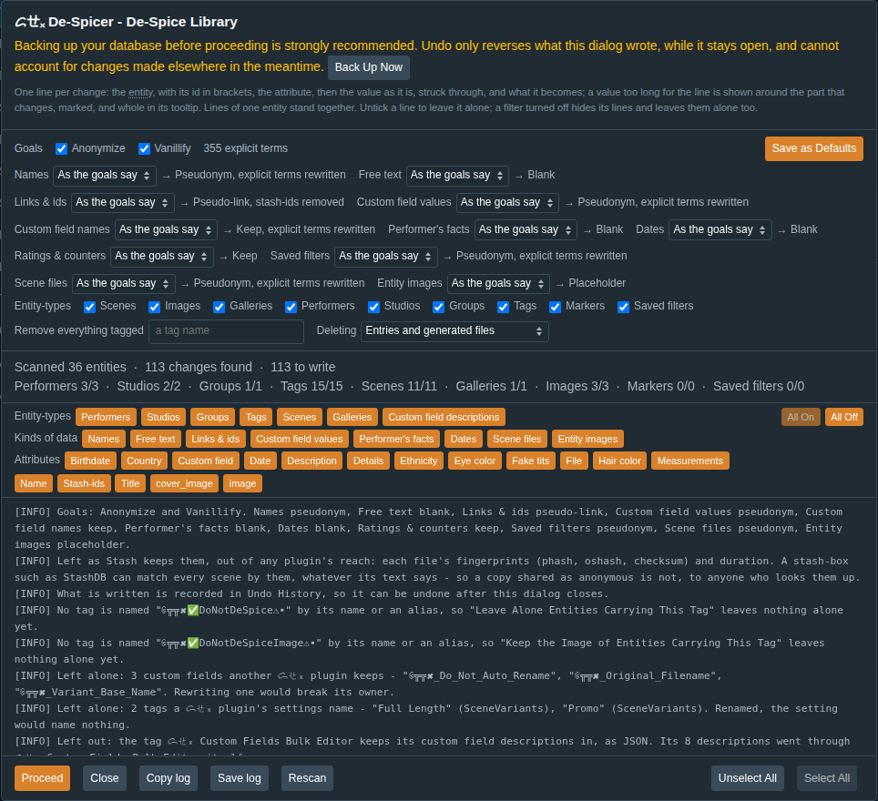
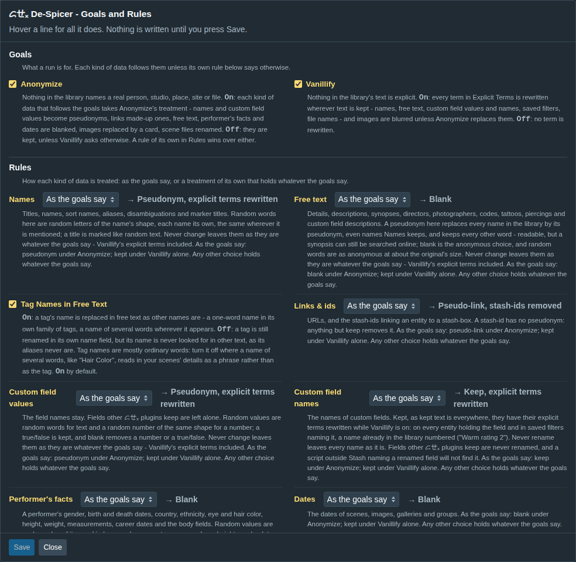
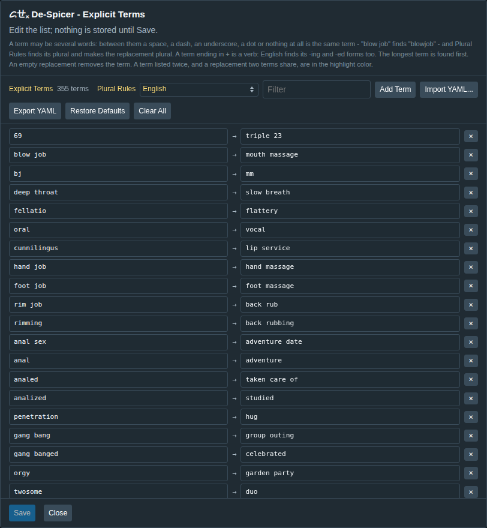
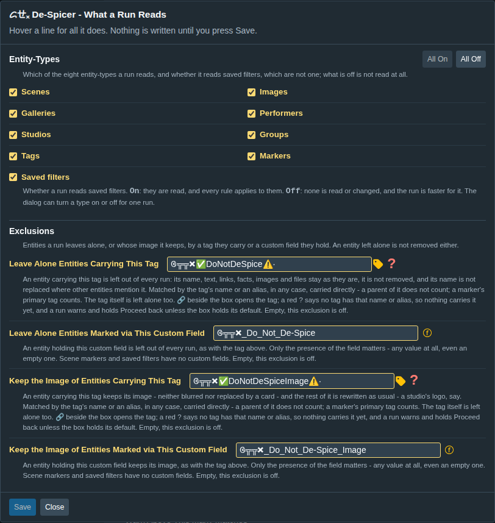
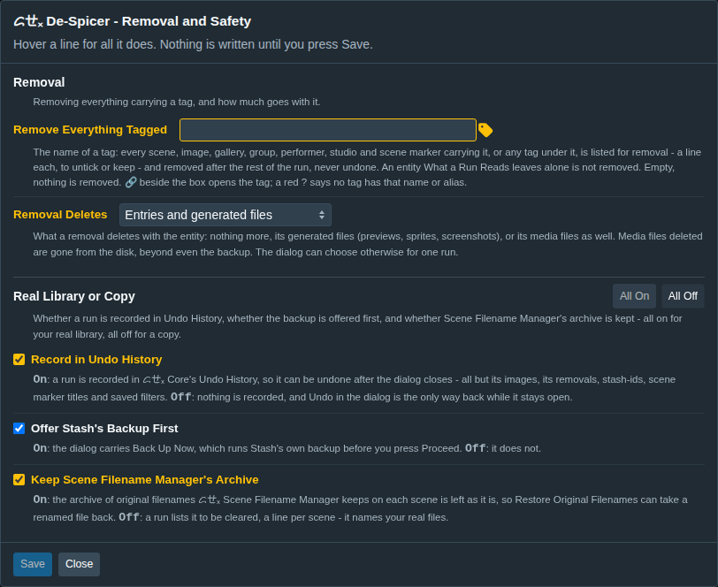

<!-- WARNING: DO NOT EDIT - GENERATED FILE. Source of truth: GTTx-DeSpicer/README.src.md, with the glossary links from GLOSSARY.src.yml and any memory table from .tools/memory-results.json. Generated by: .tools/build.js -->
# ᝯㄝₓ De-Spicer

Requires Stash 0.31.0 or newer and [ᝯㄝₓ Core](../GTTx-Core/README.md), installed and enabled alongside
it. A source index (Stash's Settings → Plugins → Available Plugins) installs Core for you; a hand
copy must copy the `GTTxCore` folder too. Without Core it does nothing but say so, in red under its name on Settings → Plugins and
Settings → Tasks and in the browser console.

[<abbr title="De-Spicer's goal of making the library's metadata and entity images non-explicit: the words you list rewritten, and the images blurred or replaced.">Vanillify</abbr>](../GLOSSARY.md#vanillify) and anonymize your library.

Stash's own **Anonymise database** writes a separate copy with every name it covers replaced by
random letters - different on every run, unreadable, and with no options. It leaves out an image's
details, photographer and code, most of a performer's facts, every date and rating, and the names
inside saved filters' criteria. This plugin rewrites the library Stash is serving, by rules you
choose, with readable, consistent replacements, and lists every change before it writes one.

## How it works

Run **De-Spice Library...** from **Settings → Tasks → Plugin Tasks**. The dialog scans every
[<abbr title="Which kind of entity an item is - scene, image, gallery, performer, studio, group, tag or scene marker. Much here is set, searched or run per entity-type.">entity-type</abbr>](../GLOSSARY.md#entity-type) and lists what the goals and rules change, one line per change: the [<abbr title="One item in a Stash library - a scene, image, gallery, performer, studio, group, tag or scene marker.">entity</abbr>](../GLOSSARY.md#entity), the
attribute, the value as it is, struck through, and what it becomes. A value too long for the line is
shown around the part that changes, marked, and whole in its tooltip. Lines of one entity stand
together. Untick what should stay, or turn off a filter by entity-type, by kind of data or by
attribute; nothing is written until **Proceed**, and **Undo** puts back exactly what was written while
the dialog stays open. **Close**, or Escape, leaves at any point but a write, an undo or a clean-up: a scan still running
ends there, and the next run scans afresh. A long listing is drawn a page at a time - as many lines as ᝯㄝₓ Core's **Lines
Drawn at Once** says, 1000 by default - under a bar pinned above the lines as they scroll, with **Previous**
and **Next**, which land on the new page's first line, and **⤒ Top** and **⤓ Bottom** within the page; Select
All, the filters and Proceed reach every line, not only the page. **All On** and **All Off**, to the right of the
filter rows, set every filter at once.



A plan of more than 20,000 changes keeps no copy of the values it changes, so a whole library fits in
the browser: each page reads its own values when it is shown, and each field is read again, checked
and worked out afresh as it is written - a field changed since the scan is still left alone and said.
A run of more than 5,000 entities keeps no copy for the dialog's own Undo either: Undo History records
it, and is where it is undone. The dialog says both before Proceed, and Copy log gives the values of
the page shown. Where Undo History will not keep such a run either - one over half its Size Limit,
which it records whole or not at all, or Image entities while ᝯㄝₓ Core's Record Library-Wide Image
Writes is off, or any of it while **Record in Undo History** is off - Proceed asks for a second press,
and a warning names what no Undo will cover. A run that draws an entity image asks the same way, at
any size, since no Undo puts an image back, and so does one that blanks a counter at any size, which
only the dialog's Undo puts back - and past the entities it keeps a copy of, nothing does.

**A scan that fails part way writes nothing.** Proceed stays off, saying why, until a **Rescan**
reads it all. ᝯㄝₓ Propagate Tags and Performers does the opposite on purpose - it adds and removes
links, and its next run completes what a partial one left. A run here renames the names themselves
and keeps no record of the real ones, so a real name in a scene the scan never reached could not be
found by any later run.

**Backing up your database before the first run is strongly recommended.** The dialog offers
Stash's own backup with **Back Up Now**.

## The goals and the rules

Two goals, either or both:



- **Anonymize** - nothing in the library names a real person, studio, place, site or file.
- **Vanillify** - nothing in its text is explicit: every term in **Explicit Terms** is rewritten.
  It makes text inoffensive, not anonymous: each term has a replacement of its own, so the rewording
  can be undone (see [What anonymity covers](#what-anonymity-covers)).

Each kind of data follows the goals unless a rule of its own says otherwise:

| Kind of data | What it covers | Anonymize does |
|---|---|---|
| Names | titles, names, sort names, aliases, disambiguations, marker titles | [<abbr title="A made-up value De-Spicer puts in place of a real one. Consistent: the same original always becomes the same pseudonym, so a performer's name in a title still matches the performer.">pseudonym</abbr>](../GLOSSARY.md#pseudonym) |
| Free text | details, descriptions, synopses, directors, photographers, codes, tattoos, piercings, custom field descriptions | blank |
| Links & ids | URLs, [<abbr title="The link from an entity in your library to its entry on a stash-box: the box's address and the entry's id.">stash-ids</abbr>](../GLOSSARY.md#stash-id) | made-up URLs; stash-ids removed |
| Custom field values | the values | pseudonym |
| Custom field names | the names of custom fields | keep |
| Performer's facts | a performer's gender, birth and death dates, country, ethnicity, eye and hair color, height, weight, measurements, career dates, body fields | blank |
| Dates | scenes', images', galleries' and groups' dates | blank |
| Ratings & counters | ratings, O-counters, play counts, resume times - a counter reset with its history, put back by the dialog's Undo only | keep |
| Saved filters | the name, and the names inside the criteria - replaced unless the filter is kept, each as Names treats that name (a placeholder there gives the entity's placeholder here; kept, it stays) | pseudonym |
| Entity images | scene covers, and performer, studio, tag and group images | placeholder |
| Scene files | the names of scenes' files on disk | pseudonym |

A rule is one of **Keep**, **Blank**, **Placeholder** (the type and id: `Performer 412`),
**Pseudonym** (named **Pseudo-link** on links & ids) or, for names, free text and saved filters, **Random
words**, where the kind allows it. **Keep** is not quite untouched while Vanillify is on: the Explicit Terms
are rewritten in kept text. So names, free text, custom field values, performer's facts and saved filters
also offer **Never change**, and scene files and custom field names **Never rename**, which leave that kind
of data exactly as it is whatever the goals say. Under Anonymize, a kind never changed is named among what
still leads back to the originals, as a kept one is. A name in random words is random letters of its shape, the same wherever
it is mentioned - in free text, in a filter's criteria - and never another's; it is kept in the same record
as the pseudonyms, while a title is marked like random text. Custom field values offer **Random values**: random words for text, and for a number another of
the same sign, digits and decimals, drawn from the entity and the field so a later run draws it again.
Performer's facts offer **Random values** too, each a value of its own kind - a gender, a country, an eye
color, a height - and a date within the ten-year span of the original (1985 to 1994, 1995 to 2004…), a
career's start in its first half and its end in its second, never in the future; an empty fact stays empty. Random
words keep the text's size, spaces and shape: every word is as many random letters of one script -
Latin most often, then accented Latin, Cyrillic, Greek, Hebrew, Arabic, Devanagari, kana or Chinese -
and every punctuation mark another. The same text always gives the same words, and they open with an
invisible word joiner (U+2060) by which a later run knows them and leaves them alone; an image is kept, **blurred** or replaced by a placeholder.
Vanillify alone blurs images. A name Stash requires - a performer's, studio's, group's or
tag's - takes a placeholder where blank was asked for. A custom field holding a number or a true/false has
no empty form, so blank removes it, and Undo puts it back; random values keep a true/false, and a
pseudonym or a placeholder keeps the number or true/false as it is. A blanked O-counter, play count
or resume time is reset by Stash's own mutation for it, which deletes its history of times; the dialog's Undo adds it back,
times and all (an image's O-counter, which has no history, counted back up), but Undo History cannot. **Custom field
names** kept have their explicit terms rewritten while Vanillify is on, as kept text does everywhere: on every
entity holding the field and in every saved filter naming it, one name for the field everywhere, a name
already in the library numbered ("Warm rating 2"); **Never rename** leaves every name as it is. Fields other
ᝯㄝₓ plugins keep are never renamed. **Entity-Types** says which of the eight
entity-types a run reads at all, and whether it reads saved filters, which are not an entity-type but
have a switch beside them; what is off is neither read nor changed, and the run is faster for it. The goals, the
types and the rules are set in the settings, and the dialog can change any of them for one run - a
change there scans again - and **Save as Defaults** keeps what it shows. A rule left as the goals say
shows after its box what they make of it now, "→ Pseudonym", in the dialog and in the settings alike,
following the goals as they are ticked. While Vanillify is on, a rule that leaves words of the original -
any but blank, random words and placeholder, on any kind but links, images, ratings and dates - adds "explicit
terms rewritten", its own choice included: Vanillify rewrites them whatever the rule. On links & ids, anything
but Keep adds "stash-ids removed".

### Pseudonyms

A pseudonym is consistent: the same original becomes the same made-up value everywhere, so a
performer's name in a scene's details, or in a saved filter's search, becomes that performer's own
pseudonym. It is the same tomorrow, too: it is derived from the original and a secret made once for
your library and kept in this plugin's settings, stored by the first Proceed. Without that secret a
pseudonym cannot be traced back to the name it replaced. A made-up name is never one already in
your library. Names are drawn from lists giving 65,536 of each kind - people, studios, [<abbr title="A group (formerly a movie) collects scenes in order; a group can hold other groups, its sub-groups.">groups</abbr>](../GLOSSARY.md#group), tags,
saved filters - so thousands of names and aliases rarely share one; a clash is tried again with
another draw, a person then takes a middle initial (`Avery Q. Ashby`), and only after both a number.
Under Vanillify a pseudonym is never one your Explicit Terms would rewrite - "Deep", a term, is
drawn again rather than written as "Roomy Harbor", which would no longer read as a pseudonym.

A run stores a short record of the name pseudonyms it wrote, about six characters each, in this
plugin's settings, so a later run - and the final check - knows its own pseudonyms exactly and
leaves them alone. A library whose first run is from this version never mistakes a real name that
happens to read like one. One run before it may hold pseudonyms from the shorter lists that came
first, which are recognized by their shape alone, so there a real name in that shape (`Kit Mercer`)
is kept as it is; titles are recognized by their shape everywhere.

Under a pseudonym, free text keeps its words but has the library's names in it replaced by their
pseudonyms - even while **Names** keeps the names themselves:

- **A name of several words** (`Jane Doe`) is replaced wherever it appears, in any case, with
  spaces, hyphens, underscores or one period between its words (`Jane-Doe`, `Jane.Doe`).
- **A name of one word** (`Summer`, `Angel`) is often an ordinary word too, so it is replaced only
  in text related to what it names: a performer's own details and its scenes, galleries and
  images, a studio's or a group's scenes, the text of what carries a tag. And only where it starts
  with a capital, as the name does: `summer` is never touched.
- **A tag's aliases** are left out: they are usually ordinary words. They are still renamed in their
  own field, and the tag's name is looked for like any other name - unless **Tag Names in Free Text**,
  a switch of the Rules, on by default, is off: then a tag is renamed in its own name field alone,
  for a library whose tag names of several words (`Hair Color`) read in its details as phrases.
- **One word naming two things** - a performer `Summer` and a tag `Summer` - is two names: each
  takes its own pseudonym in the text related to it, and each is asked about on its own.
- **A name shorter than 3 characters** (`Jo`, `AJ`) is never replaced in free text: it is too often
  part of something else. It is still renamed in its own name and alias fields.

**Names in free text** at the top of the listing asks about the one-word names the scan also found
in unrelated text, 30 of them - performers' names first, then the ones found most often - each with
**Everywhere**, **Only where related** or **Never**. Its tooltip shows where it was found, and an
answer changes the lines below at once; **Rescan** keeps the answers. Each starts on a suggestion:
**Only where related** for a word also written in lower case or found three times or more in
unrelated text (a sign of an ordinary word), **Everywhere** for a rarer one. The rest take their
suggestion, and one line counts them - except a performer's name, which past the 30 is replaced
**Everywhere**: a person's name is never left in text without being asked about. Proceed remembers
the answers to the names asked about and answered before, as salted hashes of the name and the kind
of thing it names rather than names, so a later scan asks only about names it has not shown, and an
answer about the tag `Summer` never decides a performer `Summer`; **Show the names answered before**
changes one. A saved filter or a custom field description belongs to nothing, so a one-word name is
replaced there only when the answer is **Everywhere**.

### Images

An image is drawn in your browser while Proceed writes, one at a time across the whole run, and at
most 2048 pixels on its longer side - a larger original is read at that size and written back at it,
since the blur shows nothing finer - so a library of large pictures is drawn in steady memory: fetched from Stash, blurred
by **Blur Strength** - a percentage of its longer side - or replaced by a card naming the entity,
by the name the same run gives it, in dark letters on a bright color of that entity's own. The longer
side is the one Stash fits a card by, so a wide logo of 512 by 84 and a photo of 1999 by 831 blur
alike on the page. A see-through image fades to nothing toward its edges rather than stop in a hard
line, and an opaque one shows no dark frame. The listing names the strength each blur is drawn at. An entity with no image of its own (Stash's stand-in) is
left alone, and one that cannot be drawn is left as it is and said, the entity's other changes
written. An image is not recorded in Undo History and Undo here does not put it back - holding
every original image for that would hold your library's - so the backup is the way back for it.

What the original is decides how it is drawn, and the entity's line in the log says so:

- **Animated** (a GIF, WebP or APNG of more than one frame) - blurred, it becomes a still of its
  middle frame where the browser offers `ImageDecoder`, else of its first; replaced, it becomes a canned
  looping animation (an APNG served from the plugin's own folder), or a card where that cannot be
  fetched. `ImageDecoder` is part of WebCodecs, which browsers give only to a secure page - Stash over
  HTTPS, or on `localhost` - and which Safari lacks; over plain HTTP on your network, the first frame
  it is.
- **See-through** (any transparent pixel, a logo say) - blurred or carded, it stays see-through, written
  as PNG; an opaque one is written as JPEG.
- **SVG** - drawn as an image first, 512 pixels on its longer side, then blurred.

**Every image De-Spicer writes carries its mark** - a JPEG comment or a PNG text chunk, which Stash
keeps, since it stores an upload as sent - and a later run reads it before drawing: a blurred image
is never blurred again, and a card or the canned animation is not drawn again, though a blurred image
still gives way to a card. A new image has no mark and is drawn. The scan still lists every image,
since knowing which are marked would mean downloading each one; the final check leaves them out.

### Scene files

A scene's file is renamed only where [ᝯㄝₓ Scene Filename Manager](../GTTx-SceneFilenameManager/README.md)
has archived its original name, so its **Restore Original Filenames** can always take it back; a file
with no archived name is left and counted in the log, and without Scene Filename Manager - or one too
old to be asked - no file is renamed. The new name is a pseudonym of the archived original - the same one every
run - with the extension kept; Vanillify's words are rewritten in file names too. Two files in one folder
whose originals draw the same pseudonym, or a pseudonym another file there already has, are told apart by a
number, as names are (`Silver Beacon 115 2.mp4`), the first in scan order keeping it plain. A file is moved in
its own folder, recorded in Undo History as Scene Filename Manager records its own renames. A file
moved or deleted outside Stash since its last scan cannot be renamed: the log says so, and a Scan of
its folder, then Clean, brings the library up to date - but Clean removes every entry whose file is
not on the disk or is outside Stash's library folders: in a copy whose folders point elsewhere, every entry.

The archive itself names your real files. In live mode it is kept, so Restore works; in copy mode
the run lists it to be cleared, a line per scene - unless Custom Fields Bulk Editor locks it.

### Explicit terms

A list of terms, each with the neutral word that replaces it - or none, to remove it - kept in its
own editor: a filter box, **Add Term** and a × on each row, **Import YAML...** and **Export YAML**,
**Restore Defaults** and **Clear All**; nothing is stored until **Save**. The plugin ships a default
list of over two hundred terms, each with a neutral replacement of its own, so the rewritten text
still tells them apart (`hand job = hand massage`, `foot job = foot massage`).



A term is found whole, in any case, and its replacement takes the case it was written in (`hot =
warm` makes `Hot` into `Warm` and `HOT` into `WARM`). A term may be several words: between them a
space, a dash, an underscore, a dot or nothing at all is the same term, so `blow job` also finds
`blow-job`, `the_blow_job.mp4` and `blowjob`. The longest term is found first, wherever it is
listed: `big tits` before `tits`, `anal sex` before `anal`.

**Plural Rules**, beside the count, says how a plural is handled:

- **English** (the default) - a term's plural is found with it and its replacement made plural:
  `hand jobs` becomes `hand massages`, `orgies` is found with `orgy` and becomes `house parties`,
  `dommes` with `domme` becomes `impressive women`.
- **None** - a term is found only as written, so every plural is a term of its own. For a list in
  another language, whose plurals English endings would get wrong.

A plural listed as a term is always found as written and keeps its own replacement, under either:
the default list carries `teens = young people`, since `young` made plural reads wrong.

A term ending in `+` is a verb: under **English** its -ing and -ed forms are found too, and the
replacement's last word takes the same ending - `lick+ = taste` makes `licking` into `tasting` and
`licked` into `tasted`, `shove+ = push` makes `shoving` into `pushing`. Give such a term a verb to
replace it, and list a form as a term of its own where it needs another word (`cumming = thanking`
beside `cum+ = gift`) or the replacement is irregular. Under **None** the `+` is only dropped.

The editor shows in the highlight color a term listed twice - two spellings of one term - and a
replacement two terms share, with the other named in the box's tooltip.

The YAML the editor writes, and reads back:

```yaml
plurals: english
terms:
  "blow job": "oral"
  "xxx": ""
```

It reads a hand-written list too: bare `term: replacement` lines and `- term` items.

### What anonymity covers

Anonymity comes from Anonymize's blank and pseudonym rules, and the defaults leave nothing that
leads back: names and titles get pseudonyms, free text is blanked. Text that is **kept** - a rule of
Keep, or Free Text on Pseudonym, which keeps every word but the names - can be searched for: a
title or a synopsis is mostly published text, and Vanillify's rewording is reversible on purpose. A
scan under Anonymize names every rule that still leads back to the originals, and why, before
anything is written.

Out of any plugin's reach: each file's fingerprints (phash, oshash, checksum) and duration, which
Stash keeps and a [<abbr title="A shared online database of scene, performer and studio metadata that Stash matches against and scrapes from; StashDB is the best-known one.">stash-box</abbr>](../GLOSSARY.md#stash-box) such as StashDB matches scenes by. An anonymized copy shared with
someone still identifies every scene to anyone who looks them up. The dialog says so on every
Anonymize scan.

## Removal by tag

**Remove Everything Tagged** names a tag, by its name or an alias - an alias with a warning in the
log: every scene, image, gallery, group, performer, studio and scene [<abbr title="A scene marker: a moment in a scene (a time, and optionally an end), with a title, a primary tag and other tags.">marker</abbr>](../GLOSSARY.md#marker) carrying it, or any tag
under it, is listed for removal - a line each, in red, to
untick or keep - and removed after the rest of the run is written, markers first. An entity listed
for removal gets none of its other changes, and one untagged or excluded since the scan is asked
again just before the delete and left alone. **Removal Deletes** says how much goes with it: the
library entries only, their generated files too (the default), or the media files as well. The
dialog can name another tag, or choose another level, for one run.

**A removal is not undone, here or in Undo History.** Deleted media files are gone from the disk:
not even the backup brings them back. The dialog warns before Proceed.

## After the run

While Proceed writes, the progress line counts the entities written and gives the time left at the
pace so far, taken from the third batch on (images make the first ones uneven):
`Writing 2,345 of 12,345 entities · about 3 min left`. Each entity's line in the log names what changed
rather than a count - `Studio 1494 "Only A/Cs" → "Quiet Harbor Films": name, aliases (2), details
blanked` - its entity a link with the listing's hover card, and the values themselves, before and
after, in the tooltip over the rest of the line, a long value cut around the change. A run of more
than 20,000 changes logs a count every thousand entities instead.

When Proceed has written, the dialog scans the library again with the same goals and rules - a
**final check** that writes nothing - and says what is still left for them to change: a field that
failed or moved since the scan, a line left unticked or hidden, a removal not made. **Final Check**
runs it again. A pseudonym already written is recognized and kept, so the check, and any later run,
invents nothing over it.

Then a closing summary ends the log, and the progress line opens with the same figures:

```
Done in 4 min 12 s.
  Written:  12,345 changes to 3,210 entities (2,980 names, 1,204 details, 330 images, 20 files)
  Images:   12 animated, a still of each · 40 see-through, kept so as PNG · 20 left alone, drawn by De-Spicer already
  Removed:  40 entities, markers first; media files kept
  Left:     12 changed since the scan · 3 failed · 6 unticked
  Log:      45 WARN · 2 ERROR - click to show only those lines Show all
  Final check: nothing left for these rules to change.
```

The WARN and ERROR counts narrow the log to those lines, and **Show all** brings every line back.
**Copy log** and **Save log** carry the summary; Save log downloads the log as a text file named by
the date and time, for a log too long to paste or to keep with the backup.

What Proceed does next follows what is left. With nothing left it is off - "Everything listed was
written. Close, or Rescan to start over" - and **Close** is green. With lines that failed it stays on,
its tooltip counting them, and writes them again; a line changed since the scan is left out of it,
since written now it would only be found changed again - **Rescan** lists it afresh.

Two clean-ups are offered there, each asking a second press within five seconds:

- **Delete Media Files** - where a removal kept the media files, deletes them from the disk. Not even
  the backup brings them back.
- **Run Stash's Clean** - starts Stash's own Clean task, which removes every library entry whose file is
  not on the disk or is outside Stash's library folders - in a copy whose folders point elsewhere, every
  entry - and follows it by its job id while the dialog stays open: a line under the
  progress line - `Stash's Clean: 37% · about 2 min left` - then, in the log, "finished in 3 min 05 s",
  "failed: …" or "was canceled in Stash", with Final Check offered again. Run Stash's Clean waits
  while it runs.

## Exclusions

Four settings in **What a Run Reads** leave entities alone, by a tag they carry or a custom field they hold:

- **Leave Alone Entities Carrying This Tag** and **... Marked via This Custom Field** - such an entity
  is left out of every run whole: its name, text, links, facts, image and files stay as they are, it
  is not removed, and **its name is not replaced where other entities mention it** either, so it
  reads the same everywhere.
- **Keep the Image of Entities Carrying This Tag** and **... Marked via This Custom Field** - such an
  entity keeps its image, neither blurred nor carded, and the rest of it is rewritten as usual: a
  studio's logo, say.

A tag is found as the row's 🔗 finds it - by its name or an alias, in any case - and matched
carried directly (a scene marker's primary tag counts); a custom field by its presence alone,
whatever its value - scene markers and saved filters have none. The two exclusion tags leave
themselves alone. Each box is filled in to start with - `ᱜ╦╦🞮✅DoNotDeSpice⚠∙`,
`ᱜ╦╦🞮_Do_Not_De-Spice`, `ᱜ╦╦🞮✅DoNotDeSpiceImage⚠∙` and `ᱜ╦╦🞮_Do_Not_De-Spice_Image` - so making
that tag or adding that field is all it takes; until a tag by the name exists, the row shows a red
?, the log says so, and the scan reads no entity's tags for it. A tag name of your own that no tag
has is most likely misspelled: the log warns, and **Proceed** waits until the setting names a tag
or is cleared, since the entities meant to be left alone would be rewritten. Proceed files
a description of each exclusion field in Custom Fields Bulk Editor's description [<abbr title="The tag Custom Fields Bulk Editor keeps the custom-field descriptions in.">store</abbr>](../GLOSSARY.md#store), where it has
none. The log names what was left alone, and why.

## What is left alone

- **The custom fields other ᝯㄝₓ plugins keep** - every field whose name carries the collection's
  `ᱜ╦╦🞮_` mark, and the names Scene Filename Manager's, Scene Variants' and Custom Fields Bulk
  Editor's settings give theirs. Scene Filename Manager's archive is how it restores a file's name;
  Custom Fields Bulk Editor's Hide from Add Lists field is what keeps an entity out of the add lists.
- **De-Spicer's own Leave Alone fields** - the entity and image exclusion fields keep their names and
  values on the entities they protect; renamed or blanked, they would stop protecting them.
- **The tags ᝯㄝₓ plugins work by** - every tag a plugin's settings name, by its name or an alias:
  an exclusion tag, Scene Variants' length and [<abbr title="Scene Variants' flag tag, kept on every scene that has at least one other variant, so one tag filter lists them.">flag</abbr>](../GLOSSARY.md#flag) tags, De-Spicer's own removal tag. Each keeps its
  name and aliases, here and where free text mentions it; renamed, the setting would name nothing.
- **Custom Fields Bulk Editor's description store** - the tag it keeps every field's description in,
  as JSON. The descriptions themselves are rewritten as free text, through Custom Fields Bulk
  Editor.
- **A [<abbr title="A custom field locked in Custom Fields Bulk Editor: added to, never changed or removed.">locked</abbr>](../GLOSSARY.md#lock) custom field** (Custom Fields Bulk Editor's Locked Custom Fields).
- **A field changed since the scan**: re-read before it is written, and said in the log.
- **Each file's fingerprints and duration** - Stash's own, which no plugin can change (see
  [What anonymity covers](#what-anonymity-covers)).

Each is named in the dialog's log.

## Undo History

A run is recorded in Undo History, so it can be undone after the dialog closes - except stash-ids,
scene marker titles and saved filters, which Undo History has no place for; the dialog says so
before Proceed, and its own Undo puts them back while it stays open. Entity images are neither
recorded nor undone (see [Images](#images)).

**Real Library or Copy**, in **Removal and Safety**, holds three switches - **Record in Undo History**, **Offer Stash's Backup
First** and **Keep Scene Filename Manager's Archive** - all on for your real library, all off for a
copy: a second Stash serving a backup of your library, where nothing needs undoing and the archive
of original filenames only names your real files. All three start on. **All On** and **All Off** set either answer in
one press, and say in their tooltips what each means. To set up a copy, restore a backup into a
second Stash configuration folder, start that Stash on another port and install this plugin there.

## Settings

Four rows of the plugin's group, each opening a dialog, with what it says now under it. A row of
two parts heads each in its dialog:

- **Goals and Rules** - under **Goals**, Anonymize and Vanillify, both on by default; under
  **Rules**, a dropdown per kind of data, "As the goals say" by default, and **Blur Strength**: a slider for how
  strongly an image is blurred, as a percentage of its longer side, 5 by default, 1 to 10, with a
  made-up cover beside it blurred as a run would blur it at that strength; a saved number above 10 is
  taken as 10. While Entity images does not blur - its own choice, or what the goals make of "As the
  goals say" - Blur Strength's name and number turn gray with "(inactive)" after them; the slider still
  moves, so a strength can be set ahead.
- **Explicit Terms** - the term editor, and its **Plural Rules**: English, the default, or None.
- **What a Run Reads** - under **Entity-Types**, one switch per entity-type a run reads, two to a
  line, and one for saved filters on a line of its own, since they are no entity-type, with All On and
  All Off; under **Exclusions**, the four boxes above, each tag's with
  its 🔗 (a red ? when no tag has the name or alias) and each custom field's with its ⓕ.
- **Removal and Safety** - under **Removal**, **Remove Everything Tagged**, with the tag's 🔗 beside
  the box, and **Removal Deletes**: library entries only, entries and generated files (the default),
  or entries, generated and media files; under **Real Library or Copy**, the three switches above,
  with All On and All Off.





Each row holds settings of one weight: the first three decide what a run touches, the last what lasts
beyond the rewrite - deleting, and what makes undoing possible.

## Relationship to the other plugins in this repo

- **Custom Fields Bulk Editor** - asked which custom fields are locked, and for the field
  descriptions it keeps.
- **Scene Filename Manager**, **Scene Variants** - their settings are read for the names of the
  custom fields they keep.
- **Scene Filename Manager** - asked where it keeps its archive of original filenames and what each
  scene's holds; a file is renamed only where one is archived.
- **Find & Replace Entities by Text Content** asks this plugin: its **Term counts** export says, for
  each word and phrase your library uses most, whether it is already an Explicit Term or holds one,
  and what it becomes - by the matching above, from the terms saved now. Its **De-Spicer changes**
  and **De-Spicer leaves** buttons ask which entity-types a run reads, and which text fields the goals
  and rules would change - a rule other than Keep, or Vanillify rewriting the Explicit Terms in kept
  text - or would leave with your original words in them, and search those. Its **Skip what De-Spicer
  removes** asks what a run would remove - the same lookup, Leave Alone included - and leaves it out.

## Troubleshooting

### Checking which version is actually running

A stale script is called out in red in the plugin's settings group and in the dialog's head, with
the red **Reload UI** button. The browser console (**F12** → Console) says on every page load:

```
[dsp] DeSpicer.js <version> loaded.
```

Console logging is **Log De-Spicer to the Browser Console** in ᝯㄝₓ Core's **Dev Mods**: on, every
message the dialog shows also goes to the console under the `[dsp]` prefix, so a long run can be
read back after the dialog is closed.

## Installing

Copy the `DeSpicer` folder into your Stash plugins directory (`<stash-config-dir>/plugins/`) and
reload plugins in **Settings → Plugins**.

## License

Same terms as the rest of this repository.
