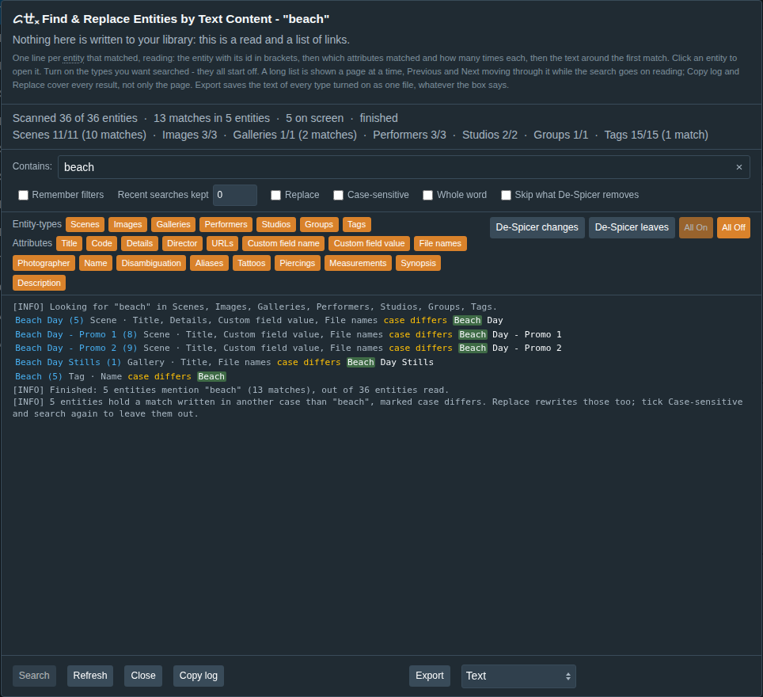

<!-- WARNING: DO NOT EDIT - GENERATED FILE. Source of truth: GTTx-FindEntitiesByTextContent/README.src.md, with the glossary links from GLOSSARY.src.yml and any memory table from .tools/memory-results.json. Generated by: .tools/build.js -->
# ᝯㄝₓ Find & Replace Entities by Text Content

Requires Stash 0.31.0 or newer and [ᝯㄝₓ Core](../GTTx-Core/README.md), installed and enabled alongside
it. A source index (Stash's Settings → Plugins → Available Plugins) installs Core for you; a hand
copy must copy the `GTTxCore` folder too. Without Core it does nothing but say so, in red under its name on Settings → Plugins and
Settings → Tasks and in the browser console.

Which [<abbr title="One item in a Stash library - a scene, image, gallery, performer, studio, group, tag or scene marker.">entities</abbr>](../GLOSSARY.md#entity) in your library mention this text — and can I change it everywhere at once?

Stash cannot be asked. It will filter a scene list on a scene's own `details`, and a
performer list on a performer's own `details`, and nothing at all on whichever custom fields
an entity happens to carry. This plugin is that one question, with one box to type it into.

## Usage

**Settings → Tasks → Plugin Tasks → Find & Replace Entities by Text Content...**

Type what to look for, turn on the [<abbr title="Which kind of entity an item is - scene, image, gallery, performer, studio, group, tag or scene marker. Much here is set, searched or run per entity-type.">entity-types</abbr>](../GLOSSARY.md#entity-type) you want searched — they all start **off**,
so nothing is read until you say so — and press **Search**. The orange **All On** and **All
Off** pair, to the right of the filter rows, sets them all at once, and each is disabled when pressing it would change nothing,
so All Off is dead the moment the dialog opens.

It looks in every text field of every type you turned on:

| Type | Fields |
|---|---|
| Scene | title, code, details, director, URLs, custom field names and values |
| Image | title, code, details, photographer, URLs, custom field names and values |
| Gallery | title, code, details, photographer, URLs, custom field names and values |
| Performer | name, disambiguation, aliases, details, URLs, tattoos, piercings, measurements, career length, custom field names and values |
| Studio | name, aliases, details, URLs, custom field names and values |
| Group | name, aliases, synopsis, director, URLs, custom field names and values |
| Tag | name, aliases, description, custom field names and values |

and in the names of a scene's, image's or gallery's files and a gallery's folder (**File names**),
which a Replace never rewrites: renaming a file on disk is ᝯㄝₓ Scene Filename Manager's.

**Attributes**, the second row of filters, choose which of those fields are read: every
attribute the types turned on have — Title, Details, Aliases, Custom field name, File names, and
so on — on unless you turn it off, and changing as the types do. Turn URLs off and neither a
search nor an export reads a URL. They start on, and turning every one off leaves Search and
Export disabled, saying so.

Which of those your Stash actually has is settled by asking it, once per search, rather than
assumed — a field this plugin looks for and your server does not have is skipped instead of
failing the whole search.

Scene [<abbr title="A scene marker: a moment in a scene (a time, and optionally an end), with a title, a primary tag and other tags.">markers</abbr>](../GLOSSARY.md#marker) are not searched: a marker carries a title and no page of its own to open.

## The results

One line per entity that matched, reading: the entity with its id in brackets, then which
attributes matched and how many times each, then the text around the first match with the
match marked. A line whose match is written in another case than what you typed — `Beach`
for `beach` — says **case differs** in the Highlighted Text Color, and the log counts them: a Replace rewrites
those too, so tick **Case-sensitive** and search again to leave them out.

The entity's name is a link to it, and **hovering it opens a card**: its picture and the
handful of fields it is recognized by — for a tag, its aliases, parents, children and
description. It is read on the first hover rather than while the list is drawn, so a search
that finds thousands of entities costs nothing for the ones you never point at.



Click one to open it in a new tab, or in this one if ᝯㄝₓ Core is set that way. An attribute
turned off after a search also hides the entities that only matched there, and drops that
attribute's chip from the ones that also matched elsewhere, so a line never claims a match it is
hiding; the next search does not read it at all. The orange **All On** / **All Off** pair covers
both rows.

**De-Spicer changes** and **De-Spicer leaves**, just before them, set both rows to the entity-types
ᝯㄝₓ De-Spicer's run reads and, of their attributes:

- **De-Spicer changes** — the ones its goals and rules rewrite: a rule other than Keep, or [<abbr title="De-Spicer's goal of making the library's metadata and entity images non-explicit: the words you list rewritten, and the images blurred or replaced.">Vanillify</abbr>](../GLOSSARY.md#vanillify)
  rewriting the Explicit Terms in what a rule keeps. For seeing what a run will reach.
- **De-Spicer leaves** — the ones where your original words survive it: kept, never renamed, or a
  [<abbr title="A made-up value De-Spicer puts in place of a real one. Consistent: the same original always becomes the same pseudonym, so a performer's name in a title still matches the performer.">pseudonym</abbr>](../GLOSSARY.md#pseudonym) in free text, which keeps every word but the names. A blank, a placeholder, random words
  or a pseudonym for a name replaces the whole value, so nothing of it is left. For finding by hand
  what De-Spicer will not clean — a word missing from its Explicit Terms, say. The log names the
  types De-Spicer does not read at all, whose text it leaves entirely.

The button in use reads **Back to mine**, which puts your own choice back, and the other switches
straight across. Remember filters keeps the view in use beside your own choice: the next time the
dialog opens it asks De-Spicer again, so the view follows De-Spicer's settings as they are then, and
Back to mine still puts yours back. A toggle clicked while a view is on is not kept. Where De-Spicer
is not installed or enabled when the dialog opens, your own choice is on, the log says so, and the
view comes back with De-Spicer. Every text field counts, a performer's measurements and
other facts among them. De-Spicer's scene markers and saved filters are not searched here, and the
log says so. The buttons are off, saying why, where De-Spicer is not installed.

**Entity-types decide which entities are read, attributes which of their fields.** The types
are locked while a search runs, since it reads the ones it started with; the attributes are
not — a search reads the ones on at the press, and a click mid-search filters the list.

The results and the messages share one box and read in
the order things happened — the line saying what is being looked for, then the results, then
whatever the run had to say afterwards.

Counters and a cycling cursor across the top say how far it has read, out of how many, and
that it is still going:

```
Scanned 4200 of 18300 entities (Images)  ·  52 matches in 37 entities  ·  37 on screen
Scenes 1200/1200 (40 matches)  ·  Galleries 0/0  ·  Images 3000/17000 (12 matches)  ·  Tags 0/100
```

The first line says how far the whole search has got, and how many times the text was found
in how many entities; the second says **where** it is. On a
library whose Images outnumber everything else, that is the difference between a number that
seems to have stopped and one that is working through the biggest type.

The totals are read once before the first page and cover only the types you turned on, so
they mean the same thing from the first page to the last. A type this Stash has none of the
searched fields on is left out of the breakdown — the log says it was skipped.

## Pausing, and the list on screen

- **Search** becomes **Pause** while it runs and **Resume** after, so a long search can be
  stopped and picked up rather than started again. Resume carries on from the page it
  stopped at; nothing is read twice.
- The list is shown **a page at a time** — as many results as ᝯㄝₓ Core's **Lines Drawn at Once**
  says, 1,000 by default — while the search goes on reading. Past one page, a bar above the list,
  pinned there as it scrolls, reads *Lines 1-1000 of 2400 found so far*, with **Previous** and
  **Next**, which land on the new page's first line, and **⤒ Top** and **⤓ Bottom** within the
  page. Next turns on as soon as a result lands past the page, and works while the search reads;
  the page you are on stays put while more arrive. Every result is kept, so going back reads
  nothing again.
- **Copy log** hands over the counters, the messages and every result the attribute filters
  leave, as plain text — every page, not only the one on screen. A filter is a choice
  about what you are looking at, so it is honored; the page is not a choice, so it is not.
- **Search** is off once a search has finished, until something it was run with changes — the
  text, **Case-sensitive**, **Whole word**, a type or an attribute — or a Replace or Undo writes.
  Its tooltip says so.
- **Refresh** throws away what this search has found and starts it again from the
  beginning, with whatever the box now says. It appears while the other button has
  become Pause or Resume — where **Search** carries the current search *on* and there is no
  other way to say *start over* — and once a search has finished with Search off, to read
  the library again after a change made somewhere else. When Search is on and would do the
  same thing, Refresh is not offered.
- **Cancel**, or the Escape key, closes it. Once a search has run out it reads **Close**
  instead — the same button, saying which of the two pressing it now means — and that Close is
  green when the list holds nothing to replace, gray while Replace still has something to do.

The **×** at the right-hand end of the box empties it. It is there only while there is
something to empty.

## Remembering

Two things the dialog can keep, both off until you ask for them, and both in **this browser**
rather than on the server:

- **Remember filters** — the entity-types you turned on, and the attributes you turned off, come
  back the next time it is opened.
- **Recent searches kept** — how many previous searches the **box itself** offers back as you
  type, the way the other boxes in these plugins do. Setting it to **zero** keeps none, and is
  also what throws away the ones already kept. The **Replace by** box keeps its own list of
  the same size: one number to answer, two lists, because offering a replacement back in the
  search box would suggest a value that has never been typed there.

**Replace itself is never remembered.** It is off every time the dialog opens.

Neither is a plugin setting, and neither writes anything: they live in the browser's own
storage. A private window, or a browser set to block site data, simply remembers nothing.

## Replacing

**Backing up your database before the first replace is strongly recommended.**

Tick **Replace** and a second line appears: what to put in place of the text you searched
for. The tick is only available once the box above says what to look for - a replacement
replaces what a search found, so there is nothing for it to offer before that. The **Replace** button then rewrites every entity on the list — so **the list you are
looking at is the plan**, every page of it, not only the one on screen. There is no second review dialog: the list already names every
entity, which attributes matched and how many times each.

Three things follow from that, and all three are worth knowing before the first press:

Every entity it rewrites gets its own **`[EDIT]`** line in the log, naming the entity and which
attributes were rewritten. It is the only kind of line that says something in your library
changed — everything else the dialog writes is about the run — so a long log can be read for the
writes alone.

- **The attribute filters narrow what a press covers.** Turn Details off and a scene that
  matched in Title and Details is still on the list as a Title match — and only its title is
  rewritten. The button's tooltip always says how many entities a press covers. An entity found
  only in its **File names** is not covered, and the log says file names are never rewritten.
- **Matching follows Case-sensitive, and the replacement goes in exactly as typed.** With
  the box unticked — the default — `beach` finds `Beach day`, and replacing with `shore`
  leaves `shore day`; ticked, only `beach` exactly as typed is found. A replacement acts on
  the setting the *search* ran with, which is what makes the list on screen the plan.
- **An empty box deletes the text it finds.** That is a thing to want, so it is allowed; a
  replacement that is *the same* as what you searched for is refused, because it would
  change nothing.

While a replacement is running, **Stop** is the only way out of the dialog — the exit and
Escape are both unavailable, because closing would leave the mutations running with nothing
on screen and take Undo's records with them. Stop finishes the batch already in flight and
leaves everything it wrote in place, still reachable by **Undo**; what it did not reach is
simply not written. An Undo can be stopped the same way, and what it did not put back - stopped
before it, or failed - stays on the pile, so pressing Undo again carries on.

The Turkish `İ` is matched as a plain `i`: its lower case is two characters, which would
put every position after it one out, so it is folded to one first — `istanbul` finds
`İstanbul`. Should a browser's case rules hold another character like it, a field holding
one is skipped rather than rewritten in the wrong place, and the log says how many were.
Tick **Case-sensitive** to search those exactly as typed.

A custom field **name** that matches is renamed, carrying its value across; a custom field
**value** that matches is updated in place. A name is never renamed onto one the entity already
has: both values are kept and the log says so. List fields — aliases, URLs — are replaced
element by element.

Every entity is **re-read immediately before it is rewritten**: the values the search found
are as old as the search, which on a large library is minutes. And every field is checked
against the update input your Stash actually has, so a field it spells differently is left
alone with a line saying so, rather than failing that entity's whole write. If those inputs
cannot be read at all, nothing is written and the log says so; pressing **Replace** again retries.

**Undo** puts back what every press since the last Undo changed, newest first, field by field,
while the dialog stays open. It
is an exact per-field inverse, not a restore of the whole record, so an unrelated edit made
in between is not reverted. The list on screen still describes what was found *before* the
write — press **Refresh** to search again. **Replace** is off while the box says something other
than what was searched: the list, and so the write, is what the search found. If another tab changes your library meanwhile, ᝯㄝₓ Core
marks **Search** (or **Refresh**, while it is showing) to say the list may be out of date. Every Replace, and every Undo, is also kept in ᝯㄝₓ Core's
[Undo History](../GTTx-Core/README.md#undo-history), where it can be undone after this dialog has closed.

## Exporting

**Export**, in the middle of the footer, saves the text of every entity-type turned on as one file,
through your browser's download - whatever the search box says, empty included. The browser never
tells a page which folder it saved to, so the log names the file and says it went to your
browser's downloads. It reads the fields a search reads, the attributes turned on alone. The dropdown
beside it picks the format, and the dialog remembers it in this browser:

| Format | The file |
|---|---|
| **Text** (`.txt`) | every value on a line of its own, with nothing saying which entity it came from |
| **JSON** (`.json`) | one array, one entity a line: its type, its id, and each field holding something, by the name Stash gives it |
| **YAML** (`.yaml`) | the same, as YAML: an item per entity, its fields beneath it |
| **Term counts (CSV)** (`.csv`) | a table of the words and phrases the text uses most, for finding the terms ᝯㄝₓ De-Spicer's Explicit Terms should carry next |

**Term counts** lists every word, and every phrase of up to three words, that occurs at least **Min
count** times (2 by default; the box appears beside the dropdown for this format alone): the
phrases of three words first, then two, then single words, each the most used first, and of two
used as often, the one more often inside a longer phrase:

```
Term,Words,Length,Total,Independent,In combo,In De-Spicer,De-Spicer replacement,Spellings
standing blow job,3,17,2,2,0,subset,standing mouth massage,
blow job,2,8,5,5,0,yes,mouth massage,blow job (3); blowjob (2)
blow,1,4,4,1,3,,,
beaches,1,7,2,2,0,yes,shores,
```

- **Length** is the term's length in characters, for sorting.
- **Total** counts every occurrence; **Independent** leaves out the ones inside a longer phrase the
  table also lists - `blow` above stands on its own once, the other three times it is part of `blow job`.
  **In combo** is those other times: Total less Independent.
- **Spellings**: a row is every spelling with the same words run together - `blow job`, `blow-job`
  and `blowjob` are one row, as De-Spicer finds one term in all three - shown as its most used
  spelling. Where there is more than one, Spellings lists each with its count, so a row that joins
  two different things (`the rapist` and `therapist`) shows it. A plural is a row of its own.
- A phrase is words joined only by spaces, dashes, underscores or dots - `blow-job` and
  `the_blow_job.mp4` both hold `blow job` - which is how De-Spicer finds a term of several words.
  A comma, a bracket or any other mark between two words ends a phrase. Words are lowered.
- **In De-Spicer** and **De-Spicer replacement** are De-Spicer's own answer: **yes** where the term
  is one of its Explicit Terms, by its matching - a plural found with its term, so `beaches` is
  `beach` - and what it becomes; **subset** where the term holds one, and what De-Spicer's
  replacement makes of the whole (`standing blow job` becomes `standing mouth massage`). Whole words
  only, as De-Spicer replaces: `therapist` holds no `rapist`. Without De-Spicer installed and enabled both stay empty, and the log says so.

The file opens in a spreadsheet as it is: it starts with the mark that tells Excel it is UTF-8.

**Stop export** ends a read part way, and **Close** does too; neither saves anything. While an
export reads, the entity-types, the format and Search wait for it.

## Nothing is written until you ask

With **Replace** off this is a read of your library and a list of links: there is no undo
because there is nothing to undo, and the head says so where a writing dialog would tell you
to back up first. Ticking Replace swaps that sentence for the backup one, which is the only
honest thing either of them can say in the other's state.

Either way it does note in its head when another ᝯㄝₓ plugin holds a bulk-edit [<abbr title="The flag a plugin holds while it writes, so the others do not react to its writes.">lease</abbr>](../GLOSSARY.md#lease) while you
search, since a result may then be a moment behind.

## Matching

A plain substring. A short word matches inside longer ones — "sea" inside "season" — which is
why the text around every result is on the line: so you can see which it was.

**Case-sensitive** is off by default: `beach` also finds `Beach`. Tick it and the text must match exactly as typed. Three things follow:

- It applies to a **replacement** as well, which finds what the search found.
- A search reads it when it **starts**, so changing it takes effect on the next search — and a
  Replace pressed afterwards still matches the way the search that drew the list did. The list is
  the plan, and a press that matched on different terms would not be acting on it.
- It is locked while a search is running, like the entity-types and for the same reason: the run
  already has its answer, so a control left live there would look like it steers something it
  cannot reach.

**It starts as ᝯㄝₓ Core's Case-Sensitive Matching setting says** — off unless you turn it on, since
somebody who wants case-sensitive matching usually wants it every search. The box then decides
for that dialog only: the setting is left as it is, and nothing is remembered in the browser.

**Skip what De-Spicer removes** leaves out of a search and an export everything ᝯㄝₓ De-Spicer would
remove: what carries its **Remove Everything Tagged** tag or a tag under it, in the types it reads, less
what its Leave Alone settings protect - De-Spicer is asked at the press, so it is exactly what a run
would remove. The log says how many were left out, and by which tag; with no tag set, or no De-Spicer,
nothing is left out and the log says why. Remembered in this browser.

**Whole word** finds the text only as a word of its own: `beach` finds `the beach.` but not
`beaches` or `sbeach`. A letter or a digit next to the match, accented letters and other scripts
included, makes it part of another word; a space, a hyphen or punctuation does not. Text that
itself starts or ends on a space or a hyphen is bounded by that character. It follows the same
three rules as Case-sensitive, and this browser remembers the box.

## No settings

There are none, on purpose. Every choice this plugin offers — what to look for, which types
to read, what to replace with, what to remember — is made inside the dialog, where you
already are. Its group on the settings page carries the description and nothing else. Where
the **Case-sensitive** box starts is ᝯㄝₓ Core's **Case-Sensitive Matching**, shared by every
ᝯㄝₓ plugin with that box. Export's format and Term counts' Min count are dialog controls too,
remembered in this browser, as is Whole word.

## Relationship to the other plugins in this repo

While **Replace** writes, this plugin takes a
[bulk-edit lease](../GTTx-Core/README.md#the-bulk-edit-lease), so the other ᝯㄝₓ plugins' automatic
modes stand down for it; while another plugin holds one, the dialog's head says so. Nothing else
overlaps: no other plugin here searches text, and the descriptions ᝯㄝₓ Custom Fields Bulk Editor
keeps are reached by ᝯㄝₓ Entity Name Maintainer, not by this search.

**[<abbr title="A custom field locked in Custom Fields Bulk Editor: added to, never changed or removed.">Locked</abbr>](../GLOSSARY.md#lock) custom fields.** Before **Replace** writes, it asks
[ᝯㄝₓ Custom Fields Bulk Editor](../GTTx-CustomFieldsBulkEditor/README.md#locked-custom-fields) which custom
fields are locked. A locked field keeps its name and its value, no field is renamed onto a locked
name, and the log lists what was left alone. If that plugin is installed but cannot answer, no
custom field is changed at all; if it is not installed, nothing is locked and the log says so.

**Other plugins' own custom fields.** A field whose name carries the collection's `ᱜ╦╦🞮_` mark, or
the name Scene Filename Manager's, Scene Variants' or Custom Fields Bulk Editor's settings give theirs
(its Hide from Add Lists field), is found by a search -
looking up an archived filename is a fair question - and never rewritten by **Replace**, which names
it in the log: rewriting one would break the plugin that keeps it.
The tag that plugin keeps its field descriptions in, as JSON, is never rewritten, whatever it is named,
and an export leaves it out.

**De-Spicer's Explicit Terms.** Export's Term counts asks
[ᝯㄝₓ De-Spicer](../GTTx-DeSpicer/README.md#explicit-terms) whether each word and phrase it lists is
already one of its terms, and what it becomes - De-Spicer's own matching, plurals included. Without
it the two De-Spicer columns are empty and the log says why.

## Notes and limitations

**Why it reads everything.** There is no server-side filter that can answer "does any text field of any type contain this
string". Each type's filter names its own fields, so a query would have to be built per type
and OR-ed across fields; and custom fields can only be filtered by naming the key up front,
with no way to ask for whichever keys an entity happens to carry. So the rows come back and
the matching happens in the browser, one page of one type at a time, with counters and a
Pause.

Turning off the types you do not need is the way to make it quick — which is why they all
start off.

**Image Replaces and Undo History.** A Replace on images is recorded in ᝯㄝₓ Core's Undo History only
with Core's **Record Library-Wide Image Writes** on, which is off by default; the dialog's own Undo
covers it either way while the dialog stays open.

## What a run costs in memory

Against a library of 100,000 scenes and 1,000,000 images, with each task set to cover everything it can — the worst case, not a typical run:

| Task | While it reads and plans | While it writes | Held for Undo |
|---|--:|--:|--:|
| Find & Replace Entities by Text Content | 830 MB | 1820 MB | 1628 MB |
| Find & Replace: Export, Term counts | 147 MB | — | — |

All of it is given back when the dialog is closed. The figures come from [MEMORY.md](../MEMORY.md), measured again for every release.

A dialog shows the last lines of its log - as many as ᝯㄝₓ Core's **Lines Drawn at Once** says, 1,000 by default - and keeps the rest so **Copy log** can hand over the
whole run. Past ᝯㄝₓ Core's **Maximum Log Lines Kept** (200,000 by default) the oldest lines are dropped
and the copy says how many went; nothing else changes — the plan, the counters, what is written
and what Undo takes back are all whole.

## Troubleshooting

**The task button does nothing.** The click is handled in the browser — there is no
server-side job behind it. If Stash instead shows an "added job to queue" toast, the page is
running a script that does not recognize the button; reload the page.

**A type is skipped with a warning.** Your Stash has none of the text fields this plugin
looks for on that type. That is the introspection check doing its job rather than a failure;
the other types are searched normally.

### Checking which version is actually running

**A red banner says the page is running an older script**, on the settings group and in the
dialog, each with a red **Reload UI** button. Press it, or reload the page — see [the
stale-script banner and the Reload UI button](../GTTx-Core/README.md#the-stale-script-banner-and-the-reload-ui-button).

## Installing

Copy the `FindEntitiesByTextContent` folder into your Stash plugins directory
(`<stash-config-dir>/plugins/`) and press **Reload plugins** in Settings → Plugins.

## License

Same terms as the rest of this repository.
